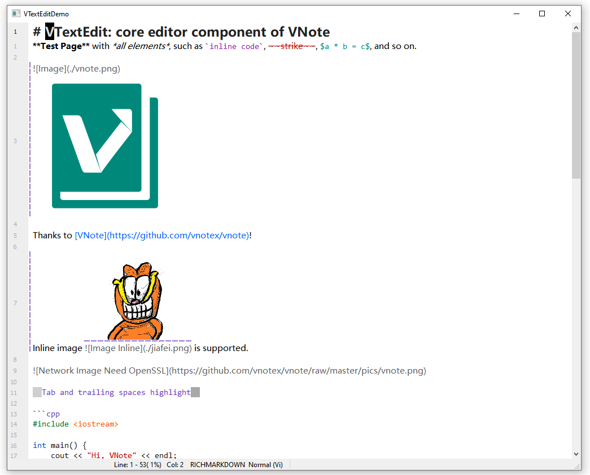

# vtextedit
This project contains the key editor components for [VNote](https://github.com/vnotex/vnote), including:

* `VTextEdit`: the basic edit widget derived from `QTextEdit`.
* `VTextEditor`: a fully-functional editor for plain text, with Vi and syntax highlight supports.
* `VMarkdownEditor`: a fully-functional editor for Markdown derived from `VTextEditor`, with in-place preview support.
* `VTypstEditor` (optional): a QWidget composition for Typst source and native compiled previews.

Check the `demo` project and VNote for details.



## Font colors in Markdown

The source editor colors the contents of matched `<font color=red>text</font>` tags.
`color` accepts named colors and hex values such as `#008000` or `#0f0`, with or without
quotes. Nested colors restore the enclosing color when closed; contents can span lines,
but each tag must fit on one line. Bold, italic, and other Markdown formatting is retained.
The tags remain visible, and the source is not rewritten.

Invalid or missing colors inherit a matched enclosing font's color. Unclosed tags do not
color the rest of the document. Tags inside Markdown code, comments, or HTML raw-text
elements are not interpreted. This is `color`-attribute support, not general CSS styling.

## Typst editor (optional)

`VTypstEditor` is additive: it contains a `VTextEditor`, not a Markdown editor, and uses
one source document, undo history and compiler session across three modes:

| `VTypstEditor::Mode` | Presentation |
| --- | --- |
| `InPlacePreview` | Editable source with source-attached compiled output cards. |
| `SideBySidePreview` | The same source beside a live, selectable PDF preview. |
| `Read` | Source hidden and input disabled; the same PDF fills the widget. |

In-place cards show rendered elements without Source/Open page actions or title/page
rows. Inline cards fit their rendered content instead of stretching across the block;
they reuse the existing editor layout reservations. Clicking a preview does not select
source or change modes. Previous/Next appears only for repeated occurrences of the
same source expression, and split output can still scroll through its rendered parts.

Changing modes does not reload source, clear undo or mark the document modified.
`setReadOnly()` records the host's explicit policy; `isReadOnly()` returns that policy.
Effective source read-only is also true in `Read`, and leaving it restores the explicit
policy. Programmatic source updates remain possible while the source is hidden. Use
`getTextEditor()` for source editing, find/replace and input modes, and `document()` for
the shared `QTextDocument`.

### Building and running

`VTEXTEDIT_ENABLE_TYPST` defaults to **OFF**. Disabled builds do not build the helper or
`VTypstEditorDemo`, install the Typst headers, or require Rust/Qt Pdf. **Typst requires
Qt 6**; Qt 5 remains supported for the existing editors with this option OFF. Configuring
Qt 5 with Typst enabled fails with an explicit error before looking for Cargo or Qt Pdf.
Enabled builds require Cargo with pinned **Rust 1.99.0**, the locked helper dependencies
(official Typst crates pinned to **0.15.1**), and **Qt 6 Pdf** in addition to the existing
Qt Widgets dependencies. Install matching Qt Gui private development headers,
LinguistTools and Core5Compat as required by the existing build. Use CMake 3.16 or later and
a toolchain supporting the selected Qt version (Qt 6.10 requires C++17); on Windows
use an MSVC Qt kit for Qt Pdf, not MinGW.

The preview is QWidget-only: it uses public Qt Pdf APIs, not PdfWidgets, Qt Quick/QML,
WebEngine, a browser, or a Tinymist/LSP server. The Typst CI baseline is Qt 6.10.3;
the native Windows/MSVC Qt 6.10.3 demo has been exercised. This is not a claim that
Linux or the full regression/packaging matrix has passed.

For a single-configuration Ninja build (replace the Qt prefix with your installed kit):

```sh
rustup toolchain install 1.99.0 --profile minimal
cmake -S . -B build-typst -G Ninja -DCMAKE_BUILD_TYPE=Release -DQT_DEFAULT_MAJOR_VERSION=6 -DCMAKE_PREFIX_PATH="/path/to/Qt/6.10.3/kit" -DVTEXTEDIT_ENABLE_TYPST=ON
cmake --build build-typst --target VTypstEditorDemo VTextEditDemo
./build-typst/bin/VTypstEditorDemo
./build-typst/bin/VTypstEditorDemo --typst-file /path/to/project/main.typ
./build-typst/bin/VTextEditDemo --typst
cmake --build build-typst # Build all installable targets before installing.
cmake --install build-typst --prefix install-typst
```

On Windows use the `.exe` names from a developer shell with the Qt runtime available.
Multi-configuration generators may place demos in a configuration subdirectory; build
and install with `--config Release`. `VTypstEditorDemo` starts Typst directly, without
`--typst`. `VTextEditDemo` retains its Markdown default and supports `--typst` when enabled;
it also accepts `--typst-file` after `--typst`. Without a file, the Typst demo uses an
in-memory example and unsaved import. With a file, its directory becomes the project
root and its basename the main entry; the demo is not a project-root discovery tool.

CMake builds the helper with `cargo build --release --locked`, places it in the build's
`bin`, and installs it in `CMAKE_INSTALL_BINDIR`. For cross compilation also set
`VTEXTEDIT_TYPST_RUST_TARGET` to the matching Rust target triple. At runtime,
`TypstEditorConfig::m_helperExecutable` overrides lookup; otherwise the editor searches
beside the application, then `PATH`. The demos accept `VTEXTEDIT_TYPST_HELPER` as that
configuration override (useful for configuration subdirectories or bundles). Deploy the
helper with your application or set an explicit path; do not rely on a developer Cargo
cache. Installing the targets does not by itself bundle all Qt/native dependencies.

### Host API and project identity

Link your host against the enabled `VTextEdit` target; it publishes the
`VTEXTEDIT_ENABLE_TYPST` compile definition. For example, within an initialized QWidget
application, with `parent` supplied by the host:

```cpp
#include <vtextedit/typsteditorconfig.h>
#include <vtextedit/vtexteditor.h>
#include <vtextedit/vtypsteditor.h>

auto config = QSharedPointer<vte::TypstEditorConfig>::create();
config->m_projectRoot = QStringLiteral("/absolute/path/to/project");
config->m_mainFile = QStringLiteral("main.typ");
config->m_allowDownloads = false; // Default: installed packages only.
auto editor = new vte::VTypstEditor(
    config, QSharedPointer<vte::TextEditorParameters>::create(), parent);
editor->setFileOverlay(QStringLiteral("lib.typ"), QStringLiteral("#let mass = 7\n"));
editor->setFileOverlay(QStringLiteral("main.typ"),
    QStringLiteral("#import \"lib.typ\": mass\n$ E = #mass c^2 $\n"));
editor->setMode(vte::VTypstEditor::Mode::SideBySidePreview);
```

`TypstEditorConfig` wraps `m_textEditorConfig` and provides helper/root/main-entry paths,
`m_fontPaths`, `m_packagePaths`, `m_allowDownloads`, `m_debounceMs`, `m_compileTimeoutMs`,
`m_maxPdfBytes`, `m_maxCacheBytes`, `m_maxRasterPixels`, `m_previewMaxHeight` and
`m_initialZoom`. Apply changes through `VTypstEditor::setConfig()`, not the contained
source editor's `setConfig()`, so Typst highlighting and preview settings are refreshed.

Overlay paths are project-root-relative. Unsaved overlays take precedence over disk;
the host supplies other open buffers with `setFileOverlay()`/`removeFileOverlay()`.
Updating the active file overlay replaces its source text. `setProject(root, mainFile)`
changes compilation root/entry, while `setActiveFile(file)` changes this editor buffer's
identity, not its contents. For Save As or switching files, the host must explicitly
update project/active identity, supply the appropriate text and remove obsolete overlays.
The active buffer stays an overlay while open; switch identity before removing it.
The helper does not save or rewrite source. Compiler snapshots use LF text and UTF-16
half-open source offsets; source saving still follows the host's line-ending policy.

Local files and installed packages work offline. `m_allowDownloads` defaults to false;
missing packages produce diagnostics rather than implicit network access. Opting in
allows helper-side Typst package downloads. File access is constrained to the selected
project and package roots, but a separate helper process is **not an OS sandbox**.
`compileStatus()`, `compileMessage()`, `diagnostics()` and their signals expose state;
`retryCompilation()` explicitly retries after a failure. Missing helpers or compilation
errors leave source editing available; failed updates retain last-good output marked stale.

### Preview and navigation semantics

In-place cards show crops of the original compiled pages for supported equations, images,
tables and figures, including page backgrounds, clipping and surrounding overlap. They
are not independently compiled formula strings or editable generated pixels. Source stays
visible. Inline cards sit above their source line; when a short source span cannot fit
the controls, the card gets its own full-width band above that same line. Repeated
evaluations have occurrence controls; split output has labeled parts.
Nested figure/table ownership avoids redundant cards. Unmapped/generated/imported objects
remain in the page preview rather than being attached to guessed active-source offsets.
Stale in-place cards are removed when input changes.

Both PDF modes use Qt Pdf text extraction for **page-local** drag selection, Copy,
Select page text, search, zoom/fit and links. A drag is clamped to its owning page;
Select page text is not whole-document Select All. Math copies as PDF-extracted plain
text, not Typst or LaTeX source; reading order, ligatures and equations follow the PDF
text model. Active selection defers new output with an Update available indication until
the selection is cleared, Update is chosen, or focus returns to source editing. Switching
between read and side-by-side keeps the same pane and selection.

PDF bytes are immutable, bounded in-memory buffers loaded through owned `QBuffer`s;
previewing does not write temporary PDFs. Each PDF document retains its buffer until
its renderer and document are retired. Compilation/export runs in the Rust helper;
Qt renders the PDF pages. In-place raster crops and PDF pages come from the same finished
document. Preview coordinates are **trim-page** points (1/72 inch), top-left origin,
y down, with the original page order. Printer bleed is excluded from preview PDF/raster
geometry; this viewer is not a print-production export UI. Resizing/zooming does not
change authored page settings or reflow the Typst document.

`showOutputAtCursor()` and Ctrl-click on output use the displayed snapshot's compiler
source mapping, which is not guaranteed to map every generated object to editable source.
Stale-output source navigation is disabled. Imported-file navigation emits
`sourceLocationRequested(file, start, end)` for the host to handle. External URLs emit
`externalLinkRequested(url)`; the host decides whether/how to open them.

## License
This project is licensed under [GNU LGPLv3](https://opensource.org/licenses/LGPL-3.0).

Enabled Typst distributions must also deploy the matching Qt Pdf runtime and its actual
native dependencies, plus applicable Qt/PDFium notices. The helper declares LGPL-3.0-only;
Typst and other Cargo dependencies, embedded/system fonts, and installed/downloaded Typst
packages retain their own licenses. Review the locked dependency graph and the fonts/packages
you distribute, and ship required license texts, attribution and source/relinking materials
as applicable. CMake installation and Cargo.lock are not an automated complete license or
runtime-dependency bundle; deployment and license compliance remain the distributor's responsibility.
